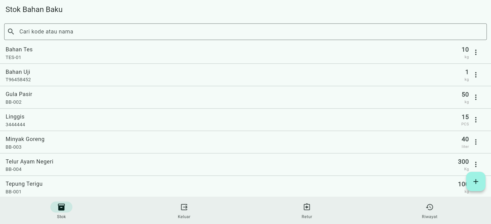
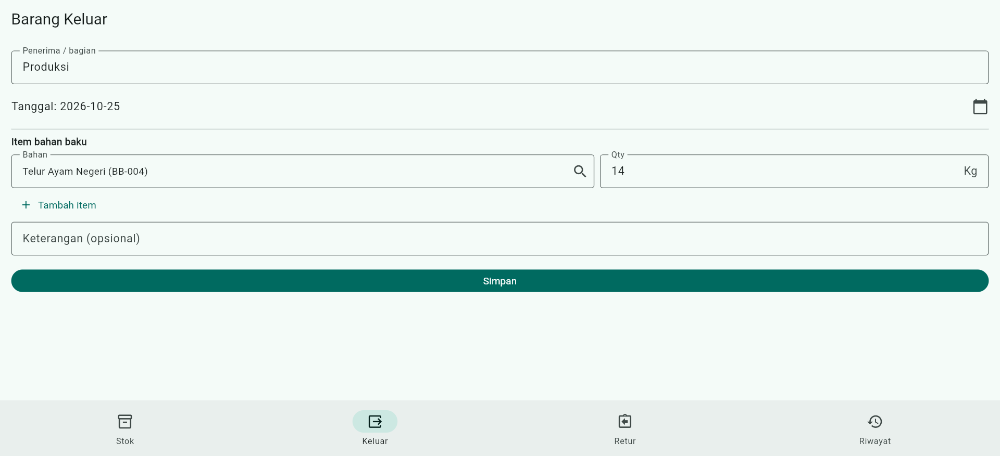
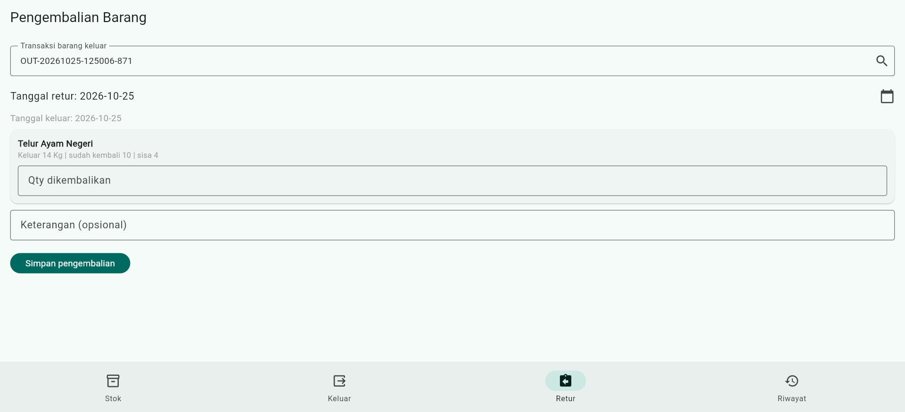
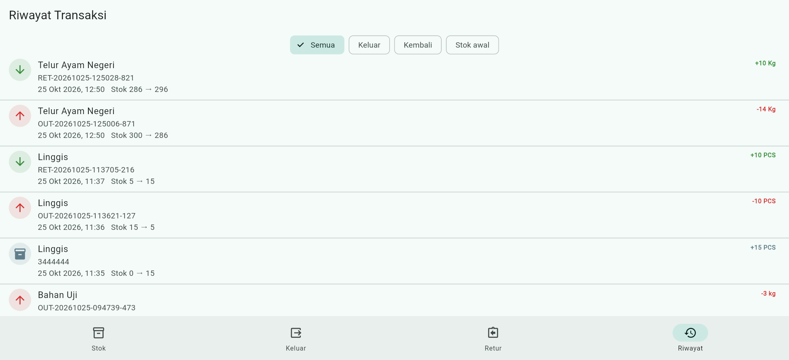
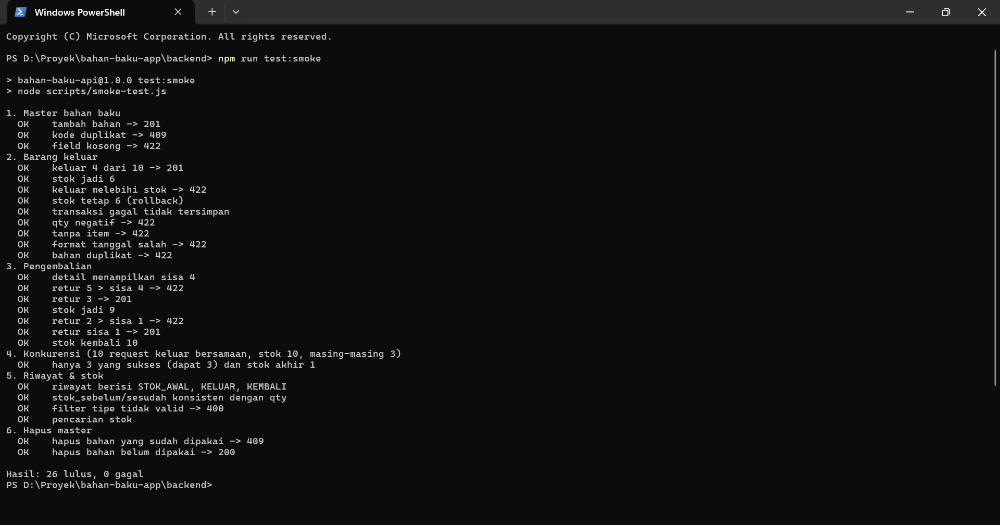
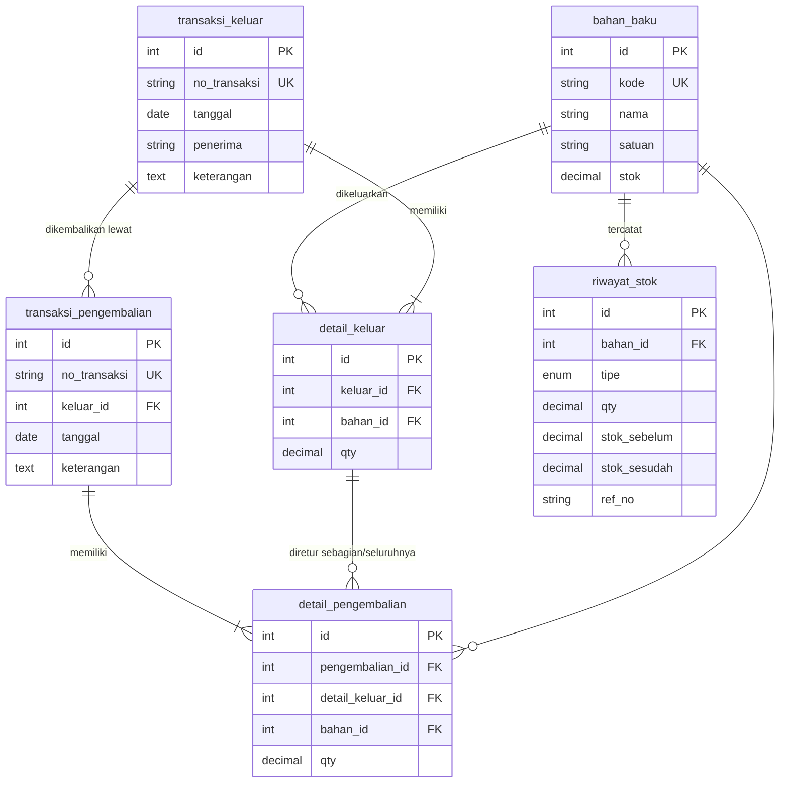

# Aplikasi Transaksi Bahan Baku

Aplikasi pencatatan **barang keluar** dan **pengembalian** bahan baku, lengkap dengan stok terkini dan riwayat pergerakan stok.
Dibuat untuk Fullstack Developer Practical Test (**Studi Kasus 4 — Transaksi Bahan Baku**).

- **Mobile**: Flutter (Dio, Material 3)
- **Backend**: Node.js + Express (REST API)
- **Database**: MySQL (diuji juga pada MariaDB 10.11)
- **Version control**: Git

## Tampilan Aplikasi

<table>
  <tr>
    <td align="center"><br><sub><b>Stok</b><br>Daftar stok terkini</sub></td>
    <td align="center"><br><sub><b>Barang Keluar</b><br>Form Barang Keluar</sub></td>
  </tr>
</table>
<table>
  <tr>
    <td align="center"><br><sub><b>Pengembalian</b><br>Qty dibatasi sisa</sub></td>
    <td align="center"><br><sub><b>Riwayat</b><br>Stok sebelum → sesudah</sub></td>
  </tr>
</table>
### Hasil pengujian otomatis

Skrip `npm run test:smoke` menguji alur bisnis utama: stok tidak cukup, rollback, batas retur, validasi input, dan 10 request bersamaan.



## Fitur

| Kebutuhan | Implementasi |
|---|---|
| Master bahan baku | CRUD + pencarian. Stok awal dicatat ke riwayat. Bahan yang sudah dipakai transaksi tidak bisa dihapus. |
| Transaksi barang keluar | Banyak item per transaksi, stok langsung berkurang. Bahan dipilih dengan pencarian (nama/kode), qty hanya menerima angka. |
| Transaksi pengembalian | Mengacu ke transaksi keluar (bisa dicari berdasarkan nomor, penerima, tanggal), qty per item dibatasi sisa yang belum dikembalikan. |
| Daftar stok terkini | Layar Stok dengan pencarian dan pull-to-refresh. |
| Riwayat transaksi | Ledger `riwayat_stok` (stok sebelum → sesudah) dengan filter tipe. |

## Aturan bisnis dan konsistensi data

1. Barang keluar **ditolak** jika stok tidak cukup (HTTP 422, pesan menyebut stok tersedia).
2. Pengembalian **tidak boleh melebihi** `qty keluar − total yang sudah dikembalikan` pada item yang sama.
3. Setiap transaksi (header + detail + update stok + riwayat) berjalan dalam **satu DB transaction**. Jika ada yang gagal, semuanya di-rollback.
4. Baris `bahan_baku` dan `detail_keluar` dikunci dengan `SELECT ... FOR UPDATE`, sehingga request bersamaan tidak membuat stok minus atau retur berlebih.
5. Stok **tidak bisa diedit langsung**; hanya berubah lewat transaksi sehingga selalu terlacak di riwayat.
6. Validasi dilakukan di dua sisi: form Flutter (validator) dan backend (422 + detail per field).

## Struktur database



Skema lengkap: [`backend/sql/schema.sql`](backend/sql/schema.sql). Data contoh: [`backend/sql/seed.sql`](backend/sql/seed.sql).

## Menjalankan aplikasi

### 1. Database
```bash
mysql -u root -p < backend/sql/schema.sql
mysql -u root -p < backend/sql/seed.sql     # opsional, data contoh
```
> Windows PowerShell tidak mendukung operator `<`. Gunakan `cmd`, atau di prompt MySQL jalankan `source backend/sql/schema.sql;`.

### 2. Backend
```bash
cd backend
npm install
cp .env.example .env        # sesuaikan DB_USER / DB_PASSWORD
npm run dev                 # atau: npm start
```
API berjalan di `http://localhost:3000`. Cek `GET /api/health`.

Uji alur bisnis otomatis (API harus sedang berjalan):
```bash
npm run test:smoke
```

### 3. Mobile (Flutter)
```bash
cd mobile
flutter pub get
flutter run                                              # emulator Android (API: 10.0.2.2:3000)
flutter run --dart-define=API_URL=http://192.168.1.5:3000/api   # HP fisik, pakai IP laptop
flutter run -d chrome --dart-define=API_URL=http://localhost:3000/api   # Chrome
```
Untuk HTTP (non-HTTPS) di Android, `AndroidManifest.xml` memakai `android:usesCleartextTraffic="true"` (hanya untuk pengembangan).

## Dokumentasi REST API

Semua respons berbentuk `{ "success": bool, "message": string, "data": ... }`.
Error validasi: `422 { "success": false, "message": "Validasi gagal", "errors": { "field": "pesan" } }`.

| Method | Endpoint | Keterangan |
|---|---|---|
| GET | `/api/health` | Cek API dan koneksi database |
| GET | `/api/bahan-baku?q=` | Daftar master (cari kode/nama) |
| GET | `/api/bahan-baku/:id` | Detail satu bahan |
| POST | `/api/bahan-baku` | Tambah `{kode, nama, satuan, stok?}` |
| PUT | `/api/bahan-baku/:id` | Ubah `{kode, nama, satuan}` (stok tidak bisa diubah) |
| DELETE | `/api/bahan-baku/:id` | Hapus (409 jika sudah dipakai transaksi) |
| GET | `/api/stok?q=` | Stok terkini |
| GET | `/api/keluar` | Daftar transaksi keluar |
| GET | `/api/keluar/:id` | Detail + `sudah_kembali` dan `sisa` per item |
| POST | `/api/keluar` | Catat barang keluar |
| GET | `/api/pengembalian` | Daftar pengembalian |
| GET | `/api/pengembalian/:id` | Detail pengembalian |
| POST | `/api/pengembalian` | Catat pengembalian |
| GET | `/api/riwayat?bahan_id=&tipe=&limit=` | Riwayat stok (`tipe`: STOK_AWAL, KELUAR, KEMBALI) |

Postman collection: [`backend/docs/postman_collection.json`](backend/docs/postman_collection.json)

### Contoh: barang keluar
```http
POST /api/keluar
{
  "tanggal": "2026-10-25",
  "penerima": "Bagian Produksi",
  "keterangan": "Batch 12",
  "items": [ { "bahan_id": 1, "qty": 10 }, { "bahan_id": 2, "qty": 2.5 } ]
}
```
Sukses `201`:
```json
{ "success": true, "message": "Transaksi barang keluar berhasil dicatat",
  "data": { "id": 1, "no_transaksi": "OUT-20261025-101530-482" } }
```
Stok tidak cukup `422`:
```json
{ "success": false, "message": "Stok Gula Pasir tidak cukup (tersedia 1, diminta 2.5 kg)", "errors": null }
```

### Contoh: pengembalian
```http
POST /api/pengembalian
{
  "keluar_id": 1,
  "tanggal": "2026-10-26",
  "items": [ { "detail_keluar_id": 1, "qty": 4 } ]
}
```
`detail_keluar_id` diambil dari `GET /api/keluar/:id`.

## Struktur proyek

```
backend/
  sql/                 schema.sql, seed.sql
  scripts/             smoke-test.js (uji alur bisnis)
  docs/                postman_collection.json
  src/
    config/            koneksi MySQL (pool)
    routes/            definisi endpoint
    controllers/       menerima request, membentuk response
    services/          logika bisnis + DB transaction
    middleware/        error handler terpusat
    utils/             helper dan AppError
mobile/lib/
  models/              model data
  services/            ApiService (Dio) + ApiException
  screens/             Stok, Form Bahan, Keluar, Retur, Riwayat
  widgets/             Loading / Error / Empty state, SearchablePicker
  utils/               format, input qty, dan sinkronisasi antar-tab
docs/
  screenshots/         gambar untuk README
```

## Asumsi dan batasan

- Tidak ada autentikasi/otorisasi (di luar lingkup test).
- Satu satuan per bahan baku; tidak ada konversi satuan.
- Nomor transaksi dibuat otomatis (`OUT-`/`RET-` + waktu + angka acak).
- Pengembalian bisa dilakukan bertahap (beberapa kali) sampai sisa nol.
- Transaksi tidak bisa diedit/dihapus (praktik pencatatan stok: koreksi dilakukan lewat transaksi baru).

## Pengembangan lanjutan

Autentikasi dan peran pengguna, pagination, dokumentasi Swagger/OpenAPI, unit test dan widget test, penyesuaian stok (stock opname), serta filter tanggal pada riwayat.
